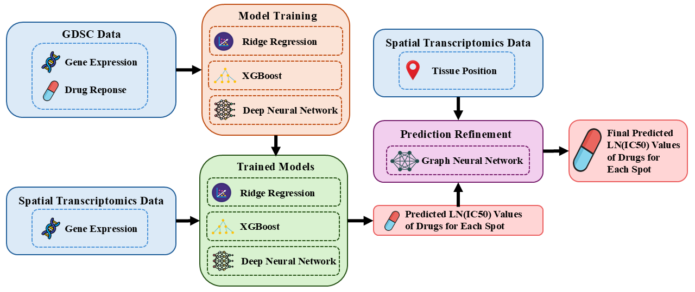

# Breast Cancer Drug Response Prediction from Spatial Gene Expression Data

This research project investigates breast cancer drug response prediction using gene expression data and integrates Machine Learning, Deep Learning, and Graph Neural Networks (GNNs) to incorporate spatial information from Spatial Transcriptomics.

## System Architecture



The workflow consists of two main stages:

1. **Model Training:** Gene expression and drug response data from GDSC are preprocessed to train Ridge Regression, XGBoost, and a Deep Neural Network (DNN).
2. **Prediction and Refinement:** The trained models predict LN(IC50) values for each spot in Spatial Transcriptomics data. Spot coordinates are used to construct a K-nearest-neighbor (KNN) graph, and GNN/GraphSAGE uses neighborhood information to refine the predictions.

## Data

- **Gene Expression:** Gene expression profiles from cancer cell lines.
- **Drug Response:** GDSC2 drug response data, with LN(IC50) as the prediction target.
- **Spatial Transcriptomics:** Seven breast cancer tissue datasets from 10x Genomics Visium, containing gene expression profiles and spatial coordinates for individual spots.

After preprocessing, the cell-line dataset contains **944 cell lines, 286 drugs, and 36,403 genes**. The modeling pipeline selects **20,000 highly variable genes (HVGs)** and reduces the feature space to **128 principal components (PCA)**, retaining **72.75% of the variance**.

| Spatial Transcriptomics Dataset | Number of Spots |
|---|---:|
| Human Breast Cancer — Block A Section 1 | 3,798 |
| Human Breast Cancer — Block A Section 2 | 3,987 |
| Human Breast Cancer — Block A Section 1 (2) | 3,813 |
| Human Breast Cancer — Block A Section 2 (2) | 4,015 |
| Visium Fresh Frozen — Whole Transcriptome | 4,898 |
| Whole Transcriptome Analysis | 4,325 |
| DCIS, Invasive Carcinoma (FFPE) | 2,518 |

**Data sources:** [GDSC](https://www.cancerrxgene.org/) · [10x Genomics Datasets](https://www.10xgenomics.com/datasets)

## Methodology

- **Ridge Regression:** Regularized linear regression for drug response prediction.
- **XGBoost:** Gradient-boosted decision trees.
- **Deep Neural Network (DNN):** A neural network for multi-output regression.
- **Spatial KNN:** Constructs edges between spatial spots based on their coordinates.
- **GNN / GraphSAGE:** Refines predicted LN(IC50) values using information from neighboring spots.

**Evaluation metrics:** MAE, RMSE, and R² for cell-line prediction; Pearson correlation, Spearman correlation, and ranking-based metrics for GNN refinement.

## Results

### Cell-Line Prediction on the Test Set

| Model | MAE ↓ | RMSE ↓ | R² ↑ |
|---|---:|---:|---:|
| Ridge Regression | 0.944201 | 1.276187 | 0.788057 |
| XGBoost | 0.978246 | 1.330859 | 0.769509 |
| DNN | 0.944260 | **1.275462** | **0.788298** |

DNN achieves the lowest RMSE and highest R² on the test set, while Ridge Regression achieves the lowest MAE. The performance difference between the two models is small.

### GNN Refinement on Spatial Transcriptomics Data

| Dataset | Pearson ↑ | Spearman ↑ | Top-10 Overlap | Top-1 Changed Rate |
|---|---:|---:|---:|---:|
| Whole Transcriptome Analysis | 0.9841 | 0.9752 | 89.93% | 2.89% |
| DCIS, Invasive Carcinoma (FFPE) | 0.9907 | 0.9848 | 88.28% | 0.20% |

For Spatial Transcriptomics, these metrics measure consistency between predictions before and after refinement. They **do not represent accuracy against experimentally measured drug response at each spot**, because ground-truth LN(IC50) labels are unavailable for the spatial datasets used in this study.

## Tech Stack

- **Programming Language:** Python
- **Data Processing:** NumPy, Pandas
- **Machine Learning:** Scikit-learn, XGBoost
- **Deep Learning:** PyTorch
- **Graph Neural Networks:** PyTorch Geometric
- **Spatial Transcriptomics:** Scanpy
- **Visualization and Application:** Matplotlib, Streamlit
- **Model Persistence:** Joblib, PyTorch

## Installation

The project uses **Python 3.12.10**.

```powershell
git clone https://github.com/pqhuy454/BreastCancerDrugResponse.git
cd BreastCancerDrugResponse

python -m venv .venv
.\.venv\Scripts\Activate.ps1

python -m pip install --upgrade pip
python -m pip install -r requirements.txt
python -m pip check
```

**Note:** Ensure that the installed PyTorch and PyTorch Geometric versions are compatible with your operating system and CPU/CUDA configuration.

## Usage

### 1. Prepare the Data

Download the required datasets from [Google Drive](https://drive.google.com/drive/folders/1_G9cfl6UxQCxKaINUNcSQ6erLEHePJFK?usp=drive_link). Extract the downloaded files and place them in the corresponding directories as shown below:

```text
data/
├── raw/          # Cell-line gene expression and drug response data
└── spatial_raw/  # Spatial transcriptomics datasets
```

Ensure that the files are placed in the correct directories and match the input paths expected by the scripts before running the pipeline.

### 2. Run the Pipeline from Start to Finish

Run the following commands from the repository root with the virtual environment activated. Execute the stages in order because later stages may depend on files generated earlier.

**Step 1 — Preprocess the cell-line data**

```powershell
python -m src.data.data_processing
```

**Step 2 — Process features and perform dimensionality reduction**

```powershell
python -m src.features.feature_processing
python -m src.features.pca_processing
```

**Step 3 — Train the base models**

```powershell
python -m src.models.train_ridge
python -m src.models.train_xgboost
python -m src.models.train_dnn
```

**Step 4 — Generate cell-line predictions and prepare spatial data**

```powershell
python -m src.predict.predict_cell_line
python -m src.spatial.spatial_processing
python -m src.spatial.build_spatial_graph
```

**Step 5 — Generate baseline predictions for spatial spots**

```powershell
python -m src.predict.predict_spatial_baseline
```

**Step 6 — Train the GNN and refine spatial predictions**

```powershell
python -m src.spatial.train_gnn
python -m src.predict.predict_spatial_gnn
```

This workflow covers preprocessing, model training, spatial prediction, and GNN-based refinement. **A separate evaluation step is not required** to run the prediction pipeline.

> **Note:** These commands assume that the scripts support execution as Python modules. If a script uses relative file paths or is designed to be executed directly, adjust the command accordingly. Confirm that the required input files, trained model checkpoints, and intermediate outputs are available before proceeding.

### 3. Launch the Streamlit Application

If you want to launch the project interface, run:

```powershell
python -m streamlit run src/app.py
```

### Expected Outputs

The pipeline is designed to produce:

- Predicted LN(IC50) values for cell lines.
- Baseline drug response predictions for individual spatial spots.
- GNN-refined LN(IC50) predictions that incorporate spatial neighborhood information.

The output files and directories depend on the configuration defined in the scripts.

## Limitations

This project is intended for research and educational purposes and is based on public datasets. Predictions derived from cell-line data and Spatial Transcriptomics do not replace experimental validation or clinical assessment and should not be used as the sole basis for treatment decisions.

## References

- [GDSC — Genomics of Drug Sensitivity in Cancer](https://www.cancerrxgene.org/)
- [10x Genomics — Spatial Gene Expression Datasets](https://www.10xgenomics.com/datasets)
- Hamilton, W., Ying, Z., and Leskovec, J. “Inductive Representation Learning on Large Graphs.” *Advances in Neural Information Processing Systems (NeurIPS)*, 2017.